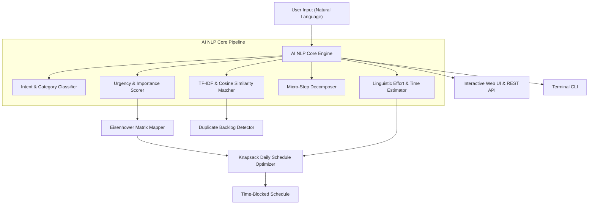

# 🤖 AI Daily Task Copilot

> An intelligent, lightweight, offline-first AI copilot designed to automate and optimize daily engineering tasks, prioritization, and time management.

[](https://www.python.org/)
[](https://fastapi.tiangolo.com/)
[](LICENSE)
[](tests/)

---

## 📌 What is This Project About?

**AI Daily Task Copilot** is a practical AI productivity assistant for software engineers, security professionals, and technical leads who deal with overwhelming, fragmented task backlogs.

Instead of manually guessing task priorities or manually building daily schedules, you simply enter your raw, natural language thoughts (e.g., *"Urgent: Fix Stripe checkout webhook timeout before 5pm and verify staging deploy"*). The built-in AI engine immediately:

1. **Classifies the Work Category**: Automatically tags tasks into *Bug Fix*, *Feature Development*, *Security & DevOps*, *Documentation & Review*, *Meeting*, or *Operations*.
2. **Evaluates Priority & Eisenhower Matrix**: Computes multi-factor Urgency and Importance scores ($0.0 \to 1.0$) and maps tasks into the 4 Eisenhower Quadrants (*Do First*, *Schedule*, *Delegate*, *Backlog*).
3. **Predicts Effort & Time (Minutes)**: Analyzes action verbs and scope modifiers to produce realistic completion time estimates.
4. **Decomposes into Actionable Micro-Steps**: Breaks down abstract or broad objectives into an executable 3-to-5 step checklist.
5. **Detects Semantic Duplicates**: Uses custom TF-IDF vectorization and Cosine Similarity to warn you if an identical or similar task is already in your backlog.
6. **Optimizes Your Daily Schedule**: Takes your working hours (e.g. 8 hours starting at 09:00) and algorithmically builds a time-blocked timeline with focus blocks and recovery breaks to prevent burnout.

---

## ⚡ Key Highlights

- **100% Offline & Private**: Zero external cloud dependency or paid API keys required. All NLP scoring and vector math run locally on your machine.
- **Dual Interface**:
  - **Modern Web Dashboard**: Glassmorphic, dark-mode single-page UI with real-time diagnostic previews.
  - **Terminal CLI**: Interactive command-line tool with rich colored tables (`rich` + `click`).
- **REST API**: Documented FastAPI backend with automated OpenAPI / Swagger docs at `/docs`.
- **Zero Heavy Bloat**: Uses optimized lightweight pure-Python NLP and NumPy vector math for sub-millisecond latency.

---

## 🏗️ Architecture



---

## 📁 Repository Structure

```
Daily tasks.push/
├── src/
│   ├── app.py                  # FastAPI server application
│   ├── cli.py                  # Rich terminal CLI
│   ├── models/
│   │   ├── __init__.py
│   │   └── task.py             # Pydantic schemas (Task, Analysis, Schedule)
│   ├── core/
│   │   ├── __init__.py         # Master analyze_task orchestrator
│   │   ├── classifier.py       # Domain-weighted category classifier
│   │   ├── priority_engine.py  # Urgency/importance scoring & Eisenhower mapping
│   │   ├── effort_estimator.py # Complexity & time prediction
│   │   ├── action_extractor.py # Actionable micro-step generator
│   │   ├── similarity.py       # TF-IDF vectorizer & cosine similarity
│   │   └── scheduler.py        # Energy-aware daily schedule optimizer
│   ├── api/
│   │   ├── __init__.py
│   │   └── routes.py           # REST API endpoints
│   └── storage/
│       ├── __init__.py
│       └── repository.py       # Local JSON repository with persistence
├── static/
│   └── index.html              # Sleek glassmorphic dark-theme Web Dashboard
├── tests/                      # Pytest automated test suite (13 tests)
│   ├── test_classifier.py
│   ├── test_priority.py
│   ├── test_similarity.py
│   ├── test_scheduler.py
│   └── test_api.py
├── run.py                      # One-click startup runner
├── pyproject.toml              # Build configuration
├── requirements.txt            # Python dependencies
└── README.md                   # Documentation
```

---

## 🚀 Quick Start Guide

### 1. Installation

Clone the repository and install requirements:

```bash
git clone https://github.com/KarthikeyanSubramaniyam/ai-task-copilot.git
cd ai-task-copilot
pip install -r requirements.txt
```

### 2. Launch the Web Dashboard

Run the one-click server script:

```bash
python run.py
```

Your browser will automatically open:
- **Web Dashboard**: [http://127.0.0.1:8000](http://127.0.0.1:8000)
- **Interactive Swagger Docs**: [http://127.0.0.1:8000/docs](http://127.0.0.1:8000/docs)

---

## 💻 Terminal CLI Usage

You can also operate the copilot directly from your terminal:

### Real-Time AI Task Analysis
```bash
python -m src.cli analyze "Urgent production bug: fix payment gateway timeout error before 5pm"
```

### Add Task to Backlog
```bash
python -m src.cli add "Audit zero-trust IAM policies" -d "Review AWS IAM roles for least-privilege enforcement"
```

### View Task Backlog
```bash
python -m src.cli list
```

### Generate Daily Time-Blocked Schedule
```bash
python -m src.cli schedule --start 09:00 --hours 8
```

---

## 🌐 REST API Endpoints

| Method | Endpoint | Description |
|---|---|---|
| `POST` | `/api/tasks/analyze` | Real-time AI analysis of any task description |
| `GET` | `/api/tasks` | List all tasks with optional completion filter |
| `POST` | `/api/tasks` | Analyze and save a new task into backlog |
| `PATCH` | `/api/tasks/{task_id}/toggle` | Toggle task completion status |
| `DELETE` | `/api/tasks/{task_id}` | Delete task from backlog |
| `POST` | `/api/schedule/generate` | Generate energy-aware time-blocked daily schedule |
| `POST` | `/api/duplicates/check` | Calculate semantic similarity against backlog |
| `GET` | `/health` | Service health status |

---

## 🧪 Running Automated Tests

Run the full pytest suite:

```bash
python -m pytest tests/ -v
```

All 13 unit and integration tests verify:
- Semantic classification accuracy across bug fixes, features, DevOps, meetings, and docs
- Priority scoring logic and Eisenhower quadrant mapping
- TF-IDF vectorization and cosine similarity duplicate matching
- Energy-aware daily schedule optimization and buffer break insertion
- FastAPI REST endpoint request/response contracts

---

## 🔒 Security & Privacy

- **Offline-by-Design**: Operates entirely locally with zero telemetry and zero external network calls.
- **Deterministic & Auditable**: Uses transparent scoring criteria and NLP heuristics without stochastic hallucinations.
- **Self-Contained Storage**: Backlog is preserved in structured JSON format locally.

---

## 👤 Author

Developed by **Karthikeyan Subramaniam**  
GitHub: [@KarthikeyanSubramaniyam](https://github.com/KarthikeyanSubramaniyam)
